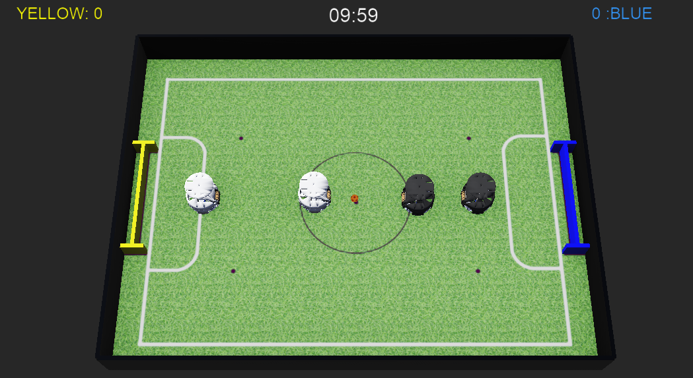
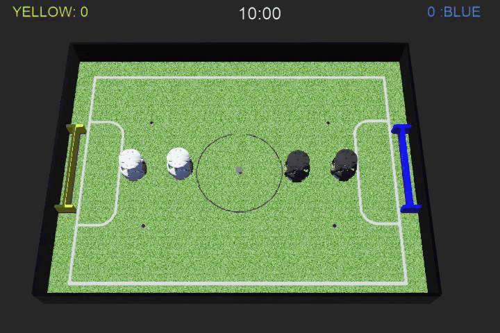

<div dir="rtl">

# شبیه ساز ربات‌های فوتبالیست پیشرفته

یک شبیه‌سازی فوتبال با چهار ربات که با استفاده از Webots ساخته شده است. این پروژه شامل زمین و توپ اختصاصی، دو تیم آبی و زرد، کنترل‌کننده‌های ربات مبتنی بر Python و یک ناظر مسابقه برای ثبت امتیازها و مدیریت روند بازی است.

> این پروژه از نسخه **R2025a** نرم افزار Webots استفاده می‌کند. برای باز کردن و اجرای world حتما از نسخه سازگار استفاده کنید.



<br>

## قابلیت ها

- دو تیم زرد و آبی که هرکدام شامل دو ربات هستند.
- ربات های تیم زرد: `Y1`, `Y2`
- ربات های تیم آبی: `B1`, `B2`
- مدل ربات‌های چهارچرخ با سیستم حرکتی چند‌جهته (Omnidirectional).
- هر ربات مجهز به حسگرهای GPS، قطب‌نما و سنسور توپ می‌باشد.
- جریمهٔ تماس با دیوار که ربات متخلف را برای مدتی به خارج از زمین منتقل می‌کند.

<br>

## ساختار فایل ها

ساختار فایل‌های پروژه شبیه سازی به صورت زیر می‌باشد.

<div dir="ltr">

```text
.
├── controllers/             # کنترلرها
│   ├── ball_controller/     # کد های توپ
│   ├── game_supervisor/     # کد های داور
│   ├── team_blue/           # کد های تیم آبی
│   └── team_yellow/         # کد های تیم زرد
├── protos/                    
└── worlds/
    ├── world.wbt            # پروژه شبیه سازی webots
    └── assets/                
```

</div>
<br>


## نرم افزارهای مورد نیاز

| Software Name | Description | Download |
|---|---|---|
| 🐍 Python | زبان برنامه نویسی پایتون. | [Download](https://www.python.org/downloads/) |
| 🤖 Webots | نرم افزار شبیه سازی. | [Download](https://cyberbotics.com/) |
| 💻 Visual Studio Code | نرم افزار ادیتور کد. | [Download](https://code.visualstudio.com/download) |
| 📦 RCJ sim v2 | پروژه شبیه سازی webots. | [Download](https://github.com/fdmxfarhan/rcj-sim-v2/archive/refs/heads/main.zip) |


<br>
<br>

## اجرای شبیه سازی

۱. پس از نصب نرم افزارها و دانلود پروژه `rcj-sim-v2` ابتدا فایل `zip` را از حالت فشرده خارج کنید.

۲. فایل `worlds/world.wbt` را باز کنید.




<!-- <video src="https://raw.githubusercontent.com/fdmxfarhan/rcj-sim-v2/main/docs/pic/world.mp4"
        autoplay
        loop
        muted
        playsinline
        width="100%">
</video> -->


</div>